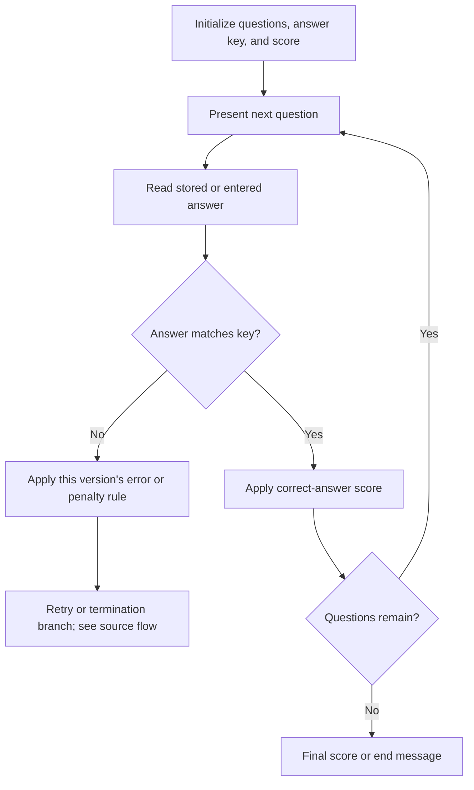
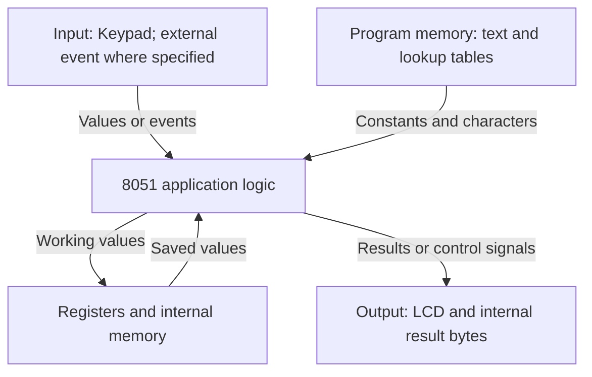

# Math Practice and Scoring

[Repository overview](../../README.md) · [Compare implementations](../README.md)

Present arithmetic questions, compare the answers with the program’s answer key, and update a score.

**Implementation:** Interrupt Gated Answer Assessment

**Input:** keypad.  
**Output:** LCD and internal result bytes.

## Inputs and results

| Parameter | Description |
| --- | --- |
| Input | An answer for each question |
| Output | Correct-answer feedback, retry feedback, and score |

## Worked example

For the question 5 + 2, enter 7. The answer matches and the score increases according to that question’s weight.

### Calculation details

The ROM tables begin with 5 and 2. The first pair adds to 7 and the program stores 07H at 18H. The next pairs compute 5 − 1 = 4, 2 × 6 = 12 and 12 ÷ 2 = 6, stored at 19H, 20H and 21H. These are the quiz answer bytes.

## Program operation

### Functional flowchart

[Detailed control flow](Control%20Flow.md)

### Simplified block diagram

**Port registers:** `P0`, `P0.0`, `P0.3`, `P0.4`, `P0.7`, `P1`, `P1.2`, `P1.3`, `P1.4`, `P1.5`, `P1.6`, `P1.7`, `P3.2`, `p1.0`, `p1.2`.

[Assembly source](source.asm)
